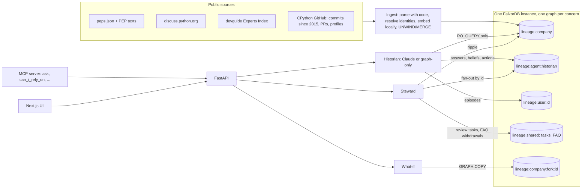

# Lineage

**A company brain that remembers *why* it believes something, and un-learns when the truth changes.**

Lineage turns an organisation's record into a FalkorDB graph of people, proposals, decisions, discussions and code,
then puts two agents on top of it:

- the **Historian** answers *why / who / when* questions from graph evidence. Every claim carries a footnote to the node
  it came from, and every answer is stored as a belief linked to that evidence.
- the **Steward** watches for change. When a decision is reversed, it walks the graph to everything that rested on the
  old truth: answers, beliefs, queued actions, published FAQ entries and the proposals that cite it. Answers are struck
  through with a dated note, beliefs go stale, actions are blocked with the chain of evidence, FAQ entries are
  withdrawn, and review tasks open. One click undoes it all.

The demo "company" is the **Python project**: 745 proposals (PEPs), the forum threads where they were argued, the
people who decided them, and who actually maintains each module, with commit history back to 2015.

> **Tracks: Agent Memory and Coordination, Company Brain.** FalkorDB *Graph Hacks: Context for AI Agents*
> (WeMakeDevs, 15–18 Oct 2026).

**What is new here, honestly stated.** None of the individual ideas is new: provenance, truth maintenance, impact
analysis, bus factor and temporal data each have decades of prior art, and products like Glean, mem0, Supermemory and
Zep do parts of this well. What Lineage puts together, on real data, is **un-learning for AI outputs**: when a fact
changes, the answers, beliefs and actions an agent built on it change too, and the agent is stopped from acting on what
it should no longer believe. It does that with FalkorDB doing the work: separate graphs, database-enforced permissions,
forks, UDFs, constraints and graph algorithms.

---

## Live demo and video

- **Live demo:** **https://web-production-662e.up.railway.app** (on Railway; how it's deployed: [docs/deploy.md](docs/deploy.md)).
  It runs the **graph-only** Historian (answers composed straight from the evidence graph, no LLM), because a
  personal Claude subscription cannot power a public site. Everything else is identical. Every visitor shares one
  demo, which resets every hour (or press **Reset demo**). Run it locally (below) for the Claude-powered Historian.
- **Demo video:** to be added before submission.

**The story to try** (works in graph-only mode too):

1. Ask *"Who decided PEP 563?"* The answer has footnotes; **Replay how this was found** lights up each step on the graph.
2. Queue **Publish to the onboarding FAQ** and run it. The gate lets it through and the entry appears in Memory.
3. Open the red pin on the time ruler and apply the real change *PEP 563 replaced by PEP 649 and PEP 749 (2025-05-05)*.
   The answer is struck in red with a dated note, the FAQ entry is withdrawn, and the 8 proposals that cite PEP 563
   get review tasks.
4. Memory, **What it believed**, "just before it learned of a change": the belief was *committed* then, *stale* now.
5. Organisation: drag the brass dial back to 2018 and see who held asyncio and typing then. Try **Find an introduction**
   and a what-if (**a person left**, **a proposal were reversed**), then **Show on the graph**.

---

## How it works



**Key design decisions**

| Decision | Why |
|---|---|
| **One graph per concern** (company, each agent, each user, shared board, what-if forks) | Isolation is enforced by FalkorDB itself, and writes are serialised *per graph*, so agents never queue behind each other. |
| **Each agent logs in as its own database user, least privilege** | The Historian may only `GRAPH.RO_QUERY` the company graph and query its own memory. No agent may delete or copy graphs, list keys, or touch config. The Steward may copy the company graph only into a `fork:*` key and delete only forks. The UI runs 12 live checks (real reads plus `ACL DRYRUN`) to prove it. |
| **Lineage crosses graphs by id** | Cypher can't join graphs, so agent memory stores `Evidence {ref:"pep:563"}` stubs. A change fans out by id and walks `DERIVED_FROM` upwards inside each agent graph. |
| **Gated actions do real work** | Publishing to the FAQ writes a shared `FaqEntry`, which the Steward withdraws when its evidence changes; asking owners opens a task for the module's actual owners. Outside agents can call `can_i_rely_on` before acting. |
| **Two time axes** | *Valid time*: what was true when (proposal status over time, commit history since 2015). *Record time*: when Lineage learned it (beliefs keep `stale_at`), so you can see what the agent believed at any moment. |
| **Counterfactuals on a `GRAPH.COPY` fork** | Algorithm procedures run over whole label sets and can't skip a node, so "what if X left" copies the graph, deletes X in the copy, re-runs them and drops the copy. |
| **Parse with code, use the LLM last** | Structured sources are parsed deterministically, so provenance is exact. Claude only phrases answers from tool results, and every citation is checked against ids the tools returned. |
| **The graph answers first, the model second** | Claude needs seconds per round trip; the graph needs milliseconds. `/ask/stream` sends each graph lookup as it happens, then an instant graph-only answer with its evidence graph (not saved to memory), then Claude's answer, which replaces it. Claude is handed that lookup in its prompt instead of making it, which saves a round trip, and if it fails (for example a usage limit) the graph-only answer stands. |
| **The database enforces the schema** | Unique ids on every record type, and `MANDATORY` constraints (a proposal must have a number and title, a decision a kind). |

---

## Graph data model

`lineage:company` holds **27,959 nodes and 67,601 relationships**.

| Node | Count | Example |
|---|---|---|
| `PEP` | 745 | `pep:649`: status, created, pagerank, `stale` |
| `Person` | 1,305 | identities merged across PEP authors, forum, GitHub (with public GitHub names) |
| `Decision` | 672 | `decision:pep:649:accept`: kind, date |
| `Thread` / `Post` | 310 / 5,708 | forum discussions (posts carry 384-d embeddings) |
| `Chunk` | 18,906 | sections of PEP text with embeddings |
| `PR` | 160 | merged CPython PRs whose title names a PEP |
| `Area` | 152 | modules and interest areas from the Experts Index |
| `Event` | 1 | a replayable real change: PEP 563 replaced (2025-05-05) |

| Relationship | Meaning |
|---|---|
| `(:Person)-[:AUTHORED]->(:PEP)`, `[:DELEGATE_FOR]` | wrote, or was given authority to decide |
| `(:Decision)-[:DECIDES]->(:PEP)` | accept, reject, supersede, withdraw, defer |
| `(:Decision)-[:ANNOUNCED_BY]->(:Person)`, `[:RECORDED_IN]->(:Post)` | who announced it, in which exact post |
| `(:PEP)-[:SUPERSEDES]->(:PEP)` | a newer proposal replaced an older one |
| `(:PEP)-[:REFERENCES {count}]->(:PEP)`, `[:REQUIRES]` | citations: **these carry the staleness ripple** |
| `(:Person)-[:EXPERT_IN {assignable, inactive}]->(:Area)` | **listed** ownership (Experts Index, today only) |
| `(:Person)-[:COMMITTED_TO {count, last_at, dates}]->(:Area)` | **actual** ownership, last 12 months |
| `(:Person)-[:WORKED_ON {dates, first_at, last_at}]->(:Area)` | full commit history since 2015 (valid time) |
| `(:Person)-[:COLLABORATED {weight}]->(:Person)`, `[:TIE {weight, cost}]` | derived collaboration; `TIE` is two-way, `cost = 1/weight` for weighted paths |
| `(:PR)-[:IMPLEMENTS]->(:PEP)`, `(:PEP)-[:CONCERNS]->(:Area)`, `(:Chunk)-[:PART_OF]->(:PEP)`, `(:Post)-[:IN]->(:Thread)` | |

**Agent memory** (`lineage:agent:<name>`):
`(:Action)-[:DERIVED_FROM]->(:Answer)-[:DERIVED_FROM]->(:Belief)-[:DERIVED_FROM]->(:Evidence {ref})`.
Beliefs are `tentative | committed | stale` with `created_at` and `stale_at`; actions are `pending | blocked | done`.

**User memory** (`lineage:user:<id>`): `(:Episode {question})-[:SUGGESTS]->(:Interest {area_ref, weight})`.
Forgetting deletes the episode, and a test proves no path back remains.

**Shared** (`lineage:shared`): `(:Agent)-[:CLAIMED {until}]->(:FixTask)`, and `(:FaqEntry {status: live|withdrawn})`.

Full design: [docs/specs/2026-10-14-lineage-design.md](docs/specs/2026-10-14-lineage-design.md).

### How this memory model compares

| | mem0 | Supermemory | Graphiti / Zep | **Lineage** |
|---|---|---|---|---|
| What is remembered | facts from conversations | facts with *updates / extends / derives* links | facts with valid-from / valid-to | company facts **and the agent's own answers, beliefs and actions, linked to their evidence** |
| When a fact changes | both versions kept with time context | newest version wins in retrieval | old edge invalidated (bi-temporal) | the change **walks into everything derived from it**: answers struck, beliefs stale, actions blocked, FAQ withdrawn, review tasks opened |
| Learns from unstructured chat | **yes** | **yes** | **yes** | no: it needs sources with explicit structure (see Limitations) |
| Isolation | per user / app filter | per container tag | `group_id` | a FalkorDB graph per agent and user, enforced by database logins |
| Maturity | production, SDKs, benchmarks | production, connectors | production | a hackathon build on one organisation |

---

## Plain search vs Lineage

Same data, same embeddings ([eval/baseline.md](eval/baseline.md), `uv run python -m eval.baseline`). **Plain search** is
vector plus full-text search over the same passages and posts, fused by rank, with the metadata a normal document store
keeps (each PEP's header with status and *Superseded-By*, each post's author and date). It is scored **generously**: a
question counts as answered if the facts appear anywhere in its top 5 results.

| | Plain search (top 5, generous) | Lineage, graph-only | Lineage, Claude |
|---|---:|---:|---:|
| The 20 eval questions | **10/20** | **20/20** | **20/20** |

Where plain search falls short: who announced a decision and when (that lives in a link between a decision, a post
and a person, not in any one passage), who is committing to a module now, a two-step supersede chain, and saying "this
isn't in the archive" (it always returns something).

**Where it does not fall short**, which matters for an honest comparison: for all 40 proposals Python marked as
superseded, plain search with PEP headers *does* show the *Superseded-By* line in its top 5. The graph's advantage is not
in showing that a document is old. It is in changing what was already concluded from it, which this test does not
measure.

---

## Cypher queries and algorithms

The FalkorDB features Lineage depends on:

| Feature | Used for |
|---|---|
| One graph per concern; `GRAPH.COPY` / `GRAPH.DELETE` | isolation; what-if forks |
| Redis ACL selectors + `ACL DRYRUN` | per-agent least-privilege logins; a live permission proof in the UI |
| **JavaScript UDFs** (`GRAPH.UDF LOAD`) | `lineage.recency` (commit weight halves every 6 months), `in_window`, `last_before`, running inside the graph query |
| `algo.pageRank` | proposal influence: search re-rank, naming topic clusters |
| `algo.SPpaths` (weighted) | **Find an introduction**: strongest working ties from a person to whoever now knows a module |
| `shortestPath` | the Historian's `connection` tool |
| `algo.betweenness` on `TIE` | bridge people in what-ifs (betweenness follows edge direction, so `TIE` is a two-way copy of `COLLABORATED`) |
| `algo.labelPropagation` | topic communities over the citation graph |
| `algo.WCC` | collaboration groups before and after a departure, on the fork |
| Vector (HNSW, cosine) + full-text indexes | hybrid retrieval over PEP text and forum posts |
| `UNIQUE` and `MANDATORY` constraints | the database rejects duplicate or malformed records |
| `GRAPH.PROFILE`, `GRAPH.MEMORY USAGE`, `GRAPH.SLOWLOG` | benchmarks, ops strip |

All **144 queries** live in [`lineage/graph/queries.py`](lineage/graph/queries.py), documented in
[docs/queries.md](docs/queries.md). Median server-side timings for the key ones are in
[docs/benchmarks.md](docs/benchmarks.md): every median is under 3 ms. The heaviest, at 2 to 2.5 ms, are the recency
UDF over every module's commit history since 2015, betweenness over all contributors, and label propagation.

The queries that matter most:

```cypher
// The staleness ripple: proposals that cite or require a changed proposal (bounded, safe on cycles)
MATCH (x:PEP)-[:REFERENCES|REQUIRES*1..1]->(c:PEP)
WHERE c.id IN $changed AND NOT x.id IN $changed AND NOT x.id IN $exclude
RETURN DISTINCT x.id AS id

// Fan-out into an agent's memory: everything it built on the changed evidence
MATCH (e:Evidence) WHERE e.ref IN $refs
SET e.stale = true, e.stale_because = $reason
WITH e MATCH (x)-[:DERIVED_FROM*1..5]->(e)
WHERE x:Belief OR x:Answer OR x:Action
RETURN DISTINCT x.id AS id, labels(x)[0] AS label

// The action gate: the root cause first
MATCH p = (a:Action {id: $id})-[:DERIVED_FROM*1..5]->(e:Evidence)
WHERE e.stale = true
RETURN [n IN nodes(p) | n.id] AS path ORDER BY length(p) DESC LIMIT 1

// Recency-weighted knowledge per module, scored by a JavaScript UDF inside the query
MATCH (p:Person)-[c:WORKED_ON]->(a:Area)
RETURN a.id, p.id, lineage.recency(c.dates, $as_of, 180) AS score

// Who could introduce you: weighted shortest path over collaboration ties
MATCH (a:Person {id: $src}), (b:Person {id: $dst})
CALL algo.SPpaths({sourceNode: a, targetNode: b, relTypes: ['TIE'], weightProp: 'cost', maxLen: 6, pathCount: 1})
YIELD path RETURN [n IN nodes(path) | n.name]

// Atomic task claim: one query is one atomic unit, and writes are serialised per graph
MATCH (t:FixTask) WHERE t.status = 'open' OR (t.status = 'claimed' AND t.claim_until <= $now)
WITH t ORDER BY t.created_at, t.id LIMIT 1
SET t.status = 'claimed', t.claimed_by = $agent, t.claim_until = $until
```

### What we found in FalkorDB along the way

Three findings in FalkorDB 6.0.2, written up with reproduction scripts, transcripts and screenshots in
[docs/upstream/](docs/upstream/README.md):

1. An aggregation grouped by a value and then a null can **crash the server** (Rust panic in `reply.rs`). It hit us
   twice during benchmarking. Others reported it first as
   [FalkorDB/FalkorDB#3150](https://github.com/FalkorDB/FalkorDB/issues/3150); a fix is in review in
   [FalkorDB/FalkorDB#3229](https://github.com/FalkorDB/FalkorDB/pull/3229); we added our data points there.
2. The documented read-only ACL pattern (`%R~`) refuses `GRAPH.RO_QUERY`, so the docs' own examples fail. ACL selectors
   work. Reported as [FalkorDB/FalkorDB#3356](https://github.com/FalkorDB/FalkorDB/issues/3356).
3. `GRAPH.UDF LOAD REPLACE` is not atomic: concurrent queries can get `Unknown function`. We now reload only when the
   code changed. Reported as [FalkorDB/FalkorDB#3357](https://github.com/FalkorDB/FalkorDB/issues/3357).

---

## Evaluation

20 questions with ground truth taken from the real graph ([eval/questions.yaml](eval/questions.yaml)): decision
announcers and dates, authors, supersede chains, "who should I ask", an as-of question, and 3 out-of-corpus questions
that must be refused. Scoring is **deterministic**: each fact has accepted phrasings, and citation recall is computed
against expected graph ids. No LLM judge.

| Backend | Correct | Citation recall | Correct abstentions | Ripple recall / precision |
|---|---|---|---|---|
| graph-only (no LLM) | **20/20** | **100%** | **3/3** | **100% / 100%** |
| Claude Opus 5.5 (via Claude Code) | **20/20** | **100%** | **3/3** | **100% / 100%** |

Claude answers take a median of 9.9 s, down from 12.1 s once Claude was handed the obvious graph lookup up front (the user sees the graph-only answer within about 50 ms meanwhile; see *Key design decisions*). Re-running the eval on 16 Oct caught a
regression: after answers gained footnotes, Claude stopped citing the proposal itself and citation recall fell to 86%.
A one-line prompt fix brought it back to 100%.

Per-question results: [eval/results-graph-only.md](eval/results-graph-only.md),
[eval/results-claude-code.md](eval/results-claude-code.md).

**Read this with care:** we wrote the 20 questions and the judge ourselves, on the data we built the graph from. 20/20
shows the system works on these questions; it is not a measure of accuracy in general.

**Tests:** 185 passing (`uv run pytest -m "not slow"`) plus 4 web tests (`npm --prefix web test`). Every test that
touches FalkorDB runs on its own throwaway graph.

---

## Setup

Requires Docker, [uv](https://docs.astral.sh/uv/) and Node 20+.

```bash
git clone https://github.com/Vaibhaav-Tiwari/lineage && cd lineage
docker volume create lineage-falkordb-data
docker compose up -d                                # FalkorDB 6.0.2 (pinned) on :6379, Browser on :3000
uv sync
cp .env.example .env                                # LLM_BACKEND=claude-code | graph-only | anthropic
uv run python -m lineage.ingest.run --offline --rewind-replays   # build the graph from the committed raw cache
uv run uvicorn lineage.api.main:app --port 8000
npm --prefix web install && npm --prefix web run dev -- -p 3001  # UI on http://localhost:3001
```

- `--offline` rebuilds from `data/raw/` with no network. Drop it to refresh from the live sources; a GitHub token is
  needed for CPython data (`GITHUB_TOKEN=$(gh auth token)`).
- **LLM backends:** `claude-code` uses your local Claude Code login through the Claude Agent SDK, with all built-in
  tools removed so Claude can only call the graph tools; `graph-only` uses no LLM; `anthropic` uses an API key.
- **MCP:** `uv run python -m lineage.mcp_server` exposes `ask`, `decision_path`, `who_knows`, `ownership_drift`,
  `departure_impact`, `can_i_rely_on` and `onboarding_faq` to Claude Desktop / Claude Code.
- **Evaluate:** `uv run python -m eval.run_eval --backend graph-only` (or `claude-code`); plain-search baseline:
  `uv run python -m eval.baseline`; query benchmarks: `uv run python -m scripts.bench_queries`.

| Path | What |
|---|---|
| `lineage/ingest/` | sources → graph (PEPs, text, experts, forum, GitHub commits and history, identities, derived edges, events) |
| `lineage/graph/` | queries, search, agent tools, ripple, ownership and truck factor, what-if, UDFs, "why no answer" |
| `lineage/memory/` | agent and user memory, action gate, real action effects, shared task board |
| `lineage/agents/` | Historian, Steward, LLM backends |
| `lineage/security.py` | live permission checks |
| `lineage/api/`, `lineage/mcp_server.py` | HTTP API, MCP server |
| `web/` | Next.js UI (Cytoscape evidence graph) |
| `eval/`, `docs/`, `scripts/` | evaluation and baseline, design docs, query docs and benchmarks, upstream findings, one-off scripts |

---

## Data sources and licenses

| Source | License / terms | How it's used |
|---|---|---|
| [peps.python.org/api/peps.json](https://peps.python.org/api/peps.json) and PEP texts ([python/peps](https://github.com/python/peps)) | Public domain / CC0-1.0 | proposals, statuses, supersede chains, text |
| [discuss.python.org](https://discuss.python.org) topic JSON (anonymous) | forum content, no explicit licence | metadata and short excerpts, always linked back to the source post |
| [python/devguide experts index](https://github.com/python/devguide/blob/main/core-team/experts.rst) | CC0-1.0 | listed ownership |
| [python/cpython](https://github.com/python/cpython) GitHub API | PSF licence; metadata only | commit dates per module (since 2015), PEP-implementing PRs, public profile names |

Only public data is used. Raw responses are cached in `data/raw/` so the graph can be rebuilt without the network; the
GitHub caches keep only what the product uses (commit id, author login, date; profile login and name).

**Privacy:** people appear by public name or handle and project role. Ownership is shown **per module**, never as a
ranking of people.

---

## Limitations

- **The data is unusually clean.** Python's proposals carry formal status, *Superseded-By* links and an experts list.
  Most companies have Slack threads, docs and tickets instead. Lineage does not yet extract decisions from unstructured
  text or notice a change nobody recorded; its one replayable change comes from Python's own metadata.
- **One organisation, no connectors.** No Slack, Jira or Docs ingestion, no user login, no multi-tenant hosting.
- **The public demo is graph-only:** answers are composed from the evidence graph by templates, not written by an AI.
- **Ownership history follows file paths** (renamed files can be missed), and the Experts Index has no history, so
  listed owners are only known for today.
- **Decision provenance has gaps:** 116 decisions are linked to the exact announcing post. Older proposals were decided
  on mailing lists, which aren't ingested, so the Historian says it doesn't know rather than guessing.
- **Small evaluation**, written by us (see above).

---

## AI assistance disclosure

Built with **Claude Code** (Claude Opus) as a pair programmer, as the rules allow: research, the design spec and plan,
test-first implementation and the UI. Decisions and trade-offs are recorded in the development ledger. The live
end-to-end runs caught the future-leak, ripple-width, link-noise, eval and FalkorDB bugs listed above. At runtime the
Historian uses Claude Opus 5.5 (through the Claude Agent SDK) only to phrase answers from graph tool results. All
embeddings are computed locally (BAAI/bge-small-en-v1.5).
