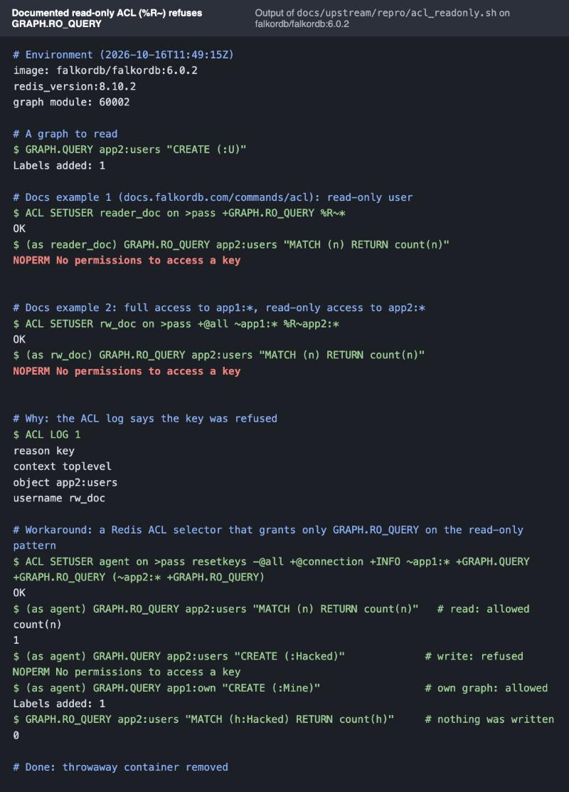

# Finding 2: the documented read-only ACL (`%R~pattern`) refuses `GRAPH.RO_QUERY`

**Status:** draft, not posted. **Severity:** medium: the documented way to give a user read-only access to a graph
does not work, so anyone following the docs ends up with either no access or full write access.
**Reproducible:** yes, deterministic.

## What we encountered

Lineage gives every AI agent its own graph and its own database login. An agent may read the company graph but must
never write it. On 14 Oct 2026 (before the hackathon started) we set this up the way the ACL page shows:
`+@all ~own:* %R~shared:*`. The agent then could not even read the shared graph: every `GRAPH.RO_QUERY` came back
`NOPERM No permissions to access a key`.

## How we found the cause

1. **Narrowing it down.** The same user could read and write its own graph. Only the `%R~` (read-only) pattern failed,
   and it failed for reads too, not just writes.
2. **Checking the docs' own examples.** On 16 Oct 2026 we re-tested both examples from
   [docs.falkordb.com/commands/acl](https://docs.falkordb.com/commands/acl) exactly as written. Both refuse a plain read:

   ```
   GRAPH.QUERY app2:users "CREATE (:U)"

   ACL SETUSER reader_doc on >pass +GRAPH.RO_QUERY %R~*
   AUTH reader_doc pass
   GRAPH.RO_QUERY app2:users "MATCH (n) RETURN count(n)"
   -> NOPERM No permissions to access a key

   ACL SETUSER rw_doc on >pass +@all ~app1:* %R~app2:*
   AUTH rw_doc pass
   GRAPH.RO_QUERY app2:users "MATCH (n) RETURN count(n)"
   -> NOPERM No permissions to access a key
   ```

   `ACL LOG` shows `reason: key`, `object: app2:users`. Our reading is that the graph commands declare their key as
   read-write, so a read-only key pattern never matches them.
3. **Finding a recipe that works.** A Redis 7+ ACL *selector* that grants only `GRAPH.RO_QUERY` on the read-only
   pattern works. We checked it two ways: really running reads and writes as the user, and `ACL DRYRUN`, which asks the
   permission engine without executing anything.

## What it meant for us, and the workaround

Without a working read-only rule, the only documented options were no access or full access, and full access defeats
the point of separating the agents. We use selectors (`lineage/db.py`, `create_acl_user`):

```
ACL SETUSER agent on >pass resetkeys -@all +@connection +INFO \
    ~own:* +GRAPH.QUERY +GRAPH.RO_QUERY +GRAPH.EXPLAIN +GRAPH.PROFILE \
    (~shared:* +GRAPH.RO_QUERY)
```

Lineage proves these boundaries live in its UI with 12 checks (`lineage/security.py`): harmless reads run as the
agent, and anything destructive is checked with `ACL DRYRUN`. `+INFO` is needed because the Python client calls `INFO`
on connect. `ACL DRYRUN` turned out to be a great, safe way to test a rule set.

## Evidence (reproduced 16 Oct 2026 on a fresh `falkordb/falkordb:6.0.2` container)

- Script: [`repro/acl_readonly.sh`](repro/acl_readonly.sh), which starts a throwaway container, runs every step, prints a transcript and removes
  the container. Rerun with `bash docs/upstream/repro/acl_readonly.sh`.
- Transcript: [`evidence/acl_readonly.txt`](evidence/acl_readonly.txt) (plain text, paste into the issue).
- Screenshot: [`evidence/acl_readonly.jpg`](evidence/acl_readonly.jpg) (the same transcript, rendered; attach to the issue).



---

## Ready-to-post issue

**Repository:** https://github.com/FalkorDB/FalkorDB/issues (or the docs repository, if a docs fix is preferred)

**Title:** Read-only graph ACLs from the docs (`%R~pattern`) refuse `GRAPH.RO_QUERY` on 6.0.2

**Body:**

> ### Summary
>
> The ACL page (https://docs.falkordb.com/commands/acl) describes `%R~<pattern>` as read-only access to a graph, with
> two examples: `+@all ~app1:* %R~app2:*` and `ACL SETUSER reader on >pass +GRAPH.RO_QUERY %R~*`. On 6.0.2 both
> refuse a plain `GRAPH.RO_QUERY` with `NOPERM No permissions to access a key`. Graph commands seem to declare their
> key as read-write, so a read-only key pattern never matches.
>
> ### Reproduction
>
> ```
> GRAPH.QUERY app2:users "CREATE (:U)"
> ACL SETUSER reader_doc on >pass +GRAPH.RO_QUERY %R~*
> AUTH reader_doc pass
> GRAPH.RO_QUERY app2:users "MATCH (n) RETURN count(n)"
> -> NOPERM No permissions to access a key
> ```
>
> Same result for `ACL SETUSER rw_doc on >pass +@all ~app1:* %R~app2:*` reading `app2:users`.
> `ACL LOG` shows `reason: key`, `object: app2:users`.
>
> ### Expected
>
> `GRAPH.RO_QUERY` succeeds; `GRAPH.QUERY` with a write clause is refused.
>
> ### Workaround that works on 6.0.2
>
> ```
> ACL SETUSER agent on >pass resetkeys -@all +@connection +INFO \
>     ~app1:* +GRAPH.QUERY +GRAPH.RO_QUERY \
>     (~app2:* +GRAPH.RO_QUERY)
> ```
>
> Reads of `app2:*` succeed, `GRAPH.QUERY app2:users "CREATE ..."` is refused, and a write sent through
> `GRAPH.RO_QUERY` is rejected by the engine. `+INFO` is needed because clients call `INFO` on connect.
> `ACL DRYRUN <user> GRAPH.RO_QUERY app2:users ...` checks a rule set safely.
>
> ### Environment
>
> `falkordb/falkordb:6.0.2` (module ver 60002), `redis_version:8.10.2`.
>
> ### Suggestion
>
> Either declare a read-only key spec for `GRAPH.RO_QUERY` (and the other read commands) so `%R~` works as documented,
> or show the selector form on the ACL page. Happy to open a docs PR with the selector example.

## Main comment

> Hi! We followed the ACL page to give each AI agent read-only access to a shared graph, and found that both
> documented `%R~` examples refuse `GRAPH.RO_QUERY` on 6.0.2. A Redis ACL selector works as a drop-in replacement. The
> repro, `ACL LOG` output and the working recipe are in the issue. If you'd prefer a docs PR with the selector
> example, we can open one.
