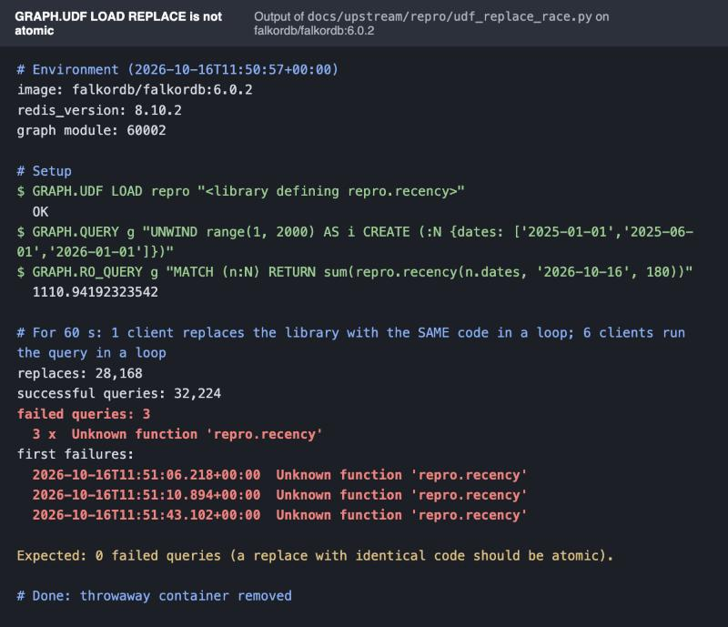

# Finding 3: `GRAPH.UDF LOAD REPLACE` is not atomic

**Status:** reported on 16 Oct 2026 as [FalkorDB/FalkorDB#3357](https://github.com/FalkorDB/FalkorDB/issues/3357). **Severity:** low to medium: queries that call a UDF fail transiently while the
library is being replaced, for example during a rolling deploy. **Reproducible:** yes, under concurrency.

## What we encountered

Lineage scores how recent each person's work on a module is with a JavaScript UDF (`lineage.recency`), so the scoring
runs inside the graph query. Our services reloaded the library with `GRAPH.UDF LOAD REPLACE` every time they started.
While investigating finding 1 we stress-tested that reload, because the crash log showed a QuickJS assertion. The
reload did not crash anything (finding 1 was a separate bug). It did show that a query calling the function can fail
in the middle of a replace.

## How we found it

In a throwaway container, one client replaced the library in a tight loop while six clients ran a query that calls
its functions over 2,000 nodes, for 60 seconds:

```
reloads: 29,696      queries: ~10,100
query errors: "Unknown function 'repro.recency'" x3, "Unknown function 'repro.last_before'" x3
```

The library was replaced with identical code every time, so the function should always exist.

## What it meant for us, and the workaround

A query arriving during a reload fails instead of seeing either the old or the new library. We now load the library
only when it is missing or its code changed: `GRAPH.UDF LIST <lib> WITHCODE`, compare, then `LOAD` or `LOAD REPLACE`
(`lineage/graph/udf.py`). UDFs persist in the snapshot across restarts, so they rarely need reloading at all.

## Evidence (reproduced 16 Oct 2026 on a fresh `falkordb/falkordb:6.0.2` container)

- Script: [`repro/udf_replace_race.py`](repro/udf_replace_race.py), which starts a throwaway container, runs every step, prints a transcript and removes
  the container. Rerun with `uv run python docs/upstream/repro/udf_replace_race.py`.
- Transcript: [`evidence/udf_replace_race.txt`](evidence/udf_replace_race.txt) (plain text, paste into the issue).
- Screenshot: [`evidence/udf_replace_race.jpg`](evidence/udf_replace_race.jpg) (the same transcript, rendered; attach to the issue).



---

## Ready-to-post issue

**Repository:** https://github.com/FalkorDB/FalkorDB/issues

**Title:** `GRAPH.UDF LOAD REPLACE` is not atomic: concurrent queries fail with `Unknown function`

**Body:**

> ### Summary
>
> While a library is being replaced with `GRAPH.UDF LOAD REPLACE`, queries that call its functions can fail with
> `Unknown function '<lib>.<fn>'`, even when the new code defines the same functions.
>
> ### Reproduction
>
> 1. `GRAPH.UDF LOAD repro "function recency(d, a, h) { ... } falkor.register('recency', recency);"`
> 2. `GRAPH.QUERY g "UNWIND range(1, 2000) AS i CREATE (:N {dates: ['2025-01-01','2025-06-01']})"`
> 3. Client A loops on `GRAPH.UDF LOAD REPLACE repro "<same code>"`.
> 4. Clients B to G loop on `GRAPH.RO_QUERY g "MATCH (n:N) RETURN sum(repro.recency(n.dates, '2026-10-16', 180))"`.
>
> Over 60 s on a fresh container: 28,168 replaces and 32,227 queries, 3 of which failed with
> `Unknown function 'repro.recency'` (timestamps in the attached transcript). It is intermittent: across four runs we saw
> between 1 and 6 failures per minute. A self-contained script that reproduces it is attached
> (`udf_replace_race.py`: starts a throwaway container, runs the loops, prints a transcript, removes the container).
>
> ### Expected
>
> A replace is atomic: a query sees either the old library or the new one.
>
> ### Environment
>
> `falkordb/falkordb:6.0.2` (module ver 60002), `redis_version:8.10.2`.

## Main comment

> Small one we noticed while load-testing UDFs on 6.0.2: replacing a library is not atomic, so a query that lands
> mid-replace gets `Unknown function`. It is rare (a few per minute under heavy load) and easy to work around (only
> replace when the code changed), but it bites during deploys. A script, transcript and screenshot are attached.
